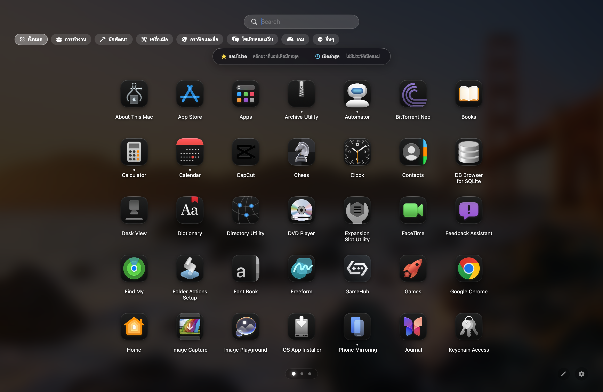
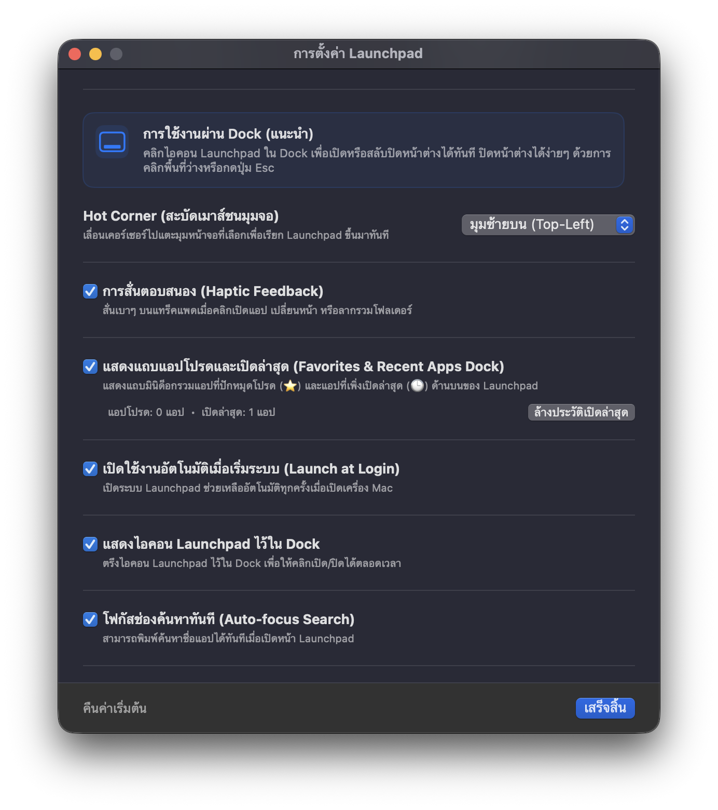
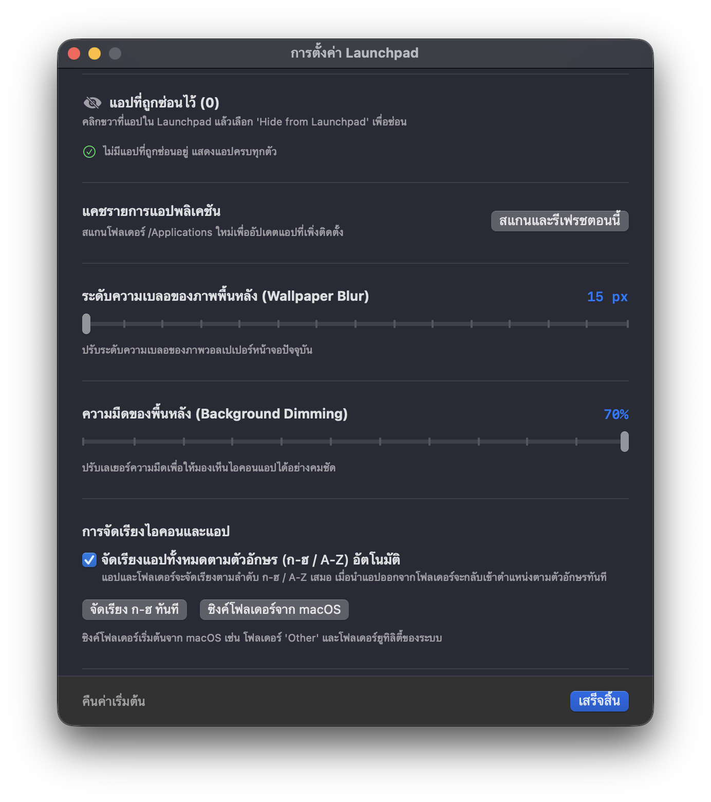

# 🚀 Launchpad for macOS (Native Swift & SwiftUI)

แอปพลิเคชัน **Launchpad** แบบเนทีฟสำหรับ macOS ยุคใหม่ (macOS 14+ / Sonoma / Sequoia / macOS 26+) พัฒนาด้วย Swift และ SwiftUI + AppKit มอบประสบการณ์การเปิดใช้งานแอปที่ลื่นไหลระดับ 120Hz ProMotion โดยไม่มีความหน่วง หน้าตาและสัดส่วนถอดแบบมาจาก Launchpad ดั้งเดิมของ Apple ด้วยดีไซน์ Frosted Glass / Glassmorphism ที่เบลอภาพพื้นหลังจากหน้าจอจริง พร้อมระบบจัดระเบียบแอปครบครัน

---

## 📸 ภาพตัวอย่างหน้าจอ (Screenshots)

### 1. หน้าจอ Launchpad หลัก (FullScreen Glassmorphism & 7×5 Grid)


<br/>

### 2. แถบแอปโปรดและเปิดล่าสุด (Favorites & Recent Apps Dock)


<br/>

### 3. หน้าต่างการตั้งค่า 2 ภาษา (Bilingual Settings - TH & EN)


<br/>

### 4. ระบบ PromptPay QR Code สำหรับโดเนทสนับสนุนผู้พัฒนา


---

## ✨ คุณสมบัติเด่น (Key Features)

1. **ดีไซน์ Frosted Glass จาก Desktop Wallpaper จริง**:
   - ดึงภาพวอลเปเปอร์หน้าจอปัจจุบันมาประมวลผลเบลอ (Gaussian Blur) แบบเรียลไทม์
   - หน้าต่างแผ่คลุมเต็มหน้าจอ 100% ขอบจรดขอบ ซ่อน Menu Bar และ Dock อย่างแนบเนียน รองรับทั้ง MacBook (มี Notch / ไม่มี Notch), Mac mini, iMac และจอภายนอก
   - มีม่านลดแสงสะท้อน (Vignette Dimming) เพื่อให้ตัวอักษรและไอคอนคมชัด อ่านง่าย

2. **กริดมาตรฐาน 7 × 5 และไอคอนขนาดใหญ่ (Native Apple Standard)**:
   - ตารางแสดงแอป 7 คอลัมน์ × 5 แถว = 35 แอปพลิเคชันต่อ 1 หน้า (ตามมาตรฐานดั้งเดิมของ macOS)
   - ไอคอนขนาดใหญ่ความละเอียดสูง (82 px) คมชัด สวยงาม ได้สัดส่วนพอดีกับทุกขนาดหน้าจอ

3. **ระบบเปลี่ยนหน้าที่ลื่นไหล ไม่กระตุก ไม่ข้ามหน้า (ProMotion 60/120Hz)**:
   - ปาด 2 นิ้วบน Trackpad ได้อย่างเป็นธรรมชาติ มีระบบ **Gesture Lock (ปาด 1 ครั้ง = ข้ามได้แค่ 1 หน้า)** ไม่มีการไหลทะลุเพราะแรงเฉื่อย (Momentum)
   - สไลด์หน้าต่อเนื่องแบบ Carousel นุ่มนวล ไม่กระตุก

4. **ระบบค้นหาแอปอัจฉริยะ (Smart Search)**:
   - เปิดขึ้นมาแล้วพิมพ์ค้นหาชื่อแอปได้ทันที (Auto-focus)
   - กดปุ่ม `Return (Enter)` เพื่อเปิดแอปแรกที่พบทันที หรือกด `Esc` เพื่อยกเลิก

5. **ระบบสร้างและจัดโฟลเดอร์ (Folder Grouping & Ungroup)**:
   - **สร้างโฟลเดอร์ใหม่**: คลิกค้างแล้วลากไอคอนแอปหนึ่งไปวางทับอีกแอปหนึ่ง
   - **นำแอปออกจากโฟลเดอร์**: เปิดโฟลเดอร์แล้วลากไอคอนแอปออกมาปล่อยที่พื้นที่ว่างด้านนอก
   - **เปลี่ยนชื่อโฟลเดอร์**: คลิกที่ชื่อโฟลเดอร์เพื่อพิมพ์แก้ไขชื่อใหม่ได้ทันที

6. **โหมดจัดระเบียบสั่นดุ๊กดิ๊ก (Jiggle Edit Mode)**:
   - คลิกปุ่มดินสอด้านขวาล่าง หรือคลิกค้างที่ไอคอนแอปใดๆ เพื่อเข้าสู่โหมดแก้ไข
   - ไอคอนจะเริ่มสั่นดุ๊กดิ๊ก พร้อมแสดงปุ่ม `(x)` เพื่อซ่อนแอปได้อย่างรวดเร็ว

7. **🟢 ไฟสถานะแอปที่กำลังเปิดอยู่ (Running App Indicators)**:
   - แสดงจุดไฟสีขาวเนียนตาใต้ไอคอนแอป (และไอคอนโฟลเดอร์) ที่กำลังเปิดทำงานอยู่ในระบบจริง แบบเดียวกับจุดไฟใต้ไอคอนใน Dock ของ macOS

8. **⭐ แถบแอปโปรดและเปิดล่าสุด (Favorites & Recent Apps Dock)**:
   - แถบมินิด็อกกระจก Frosted Glass ลอยตัวด้านบน แสดงผลทั้งแอปที่ปักหมุดเป็นแอปโปรด (⭐) และแอปที่เพิ่งเปิดใช้งานล่าสุด (🕒)
   - ปักหมุดแอปใดๆ เป็นแอปโปรดได้ง่ายๆ เพียงคลิกขวาที่ไอคอนแอปแล้วเลือก **ปักหมุดเป็นแอปโปรด**
   - รองรับเอฟเฟกต์ชี้เมาส์ขยายไอคอน (Hover Magnification) และแสดงไฟสถานะแอปที่รันอยู่ใต้ไอคอนทันที
   - คลิกขวาที่ไอคอนในด็อกเพื่อเปิด, แสดงใน Finder, ถอนหมุด หรือลบออกจากรายการล่าสุด

9. **คลิกขวาที่ไอคอนแอป (Context Menu)**:
   - **Pin to Favorites / Unpin**: ปักหมุดเป็นแอปโปรด หรือถอนหมุดออกจากแถบด็อก
   - **Show in Finder**: เปิดดูตำแหน่งไฟล์แอปใน Finder
   - **Copy Path**: คัดลอก Path ของแอปไปยัง Clipboard
   - **Hide from Launchpad**: ซ่อนแอปที่ไม่ต้องการเห็น

10. **หน้าต่างการตั้งค่า 2 ภาษา (Bilingual Unified Settings - Thai & English)**:
   - สลับเปลี่ยนภาษาได้ทันทีที่ด้านบนสุดระหว่าง **ภาษาไทย (TH)** และ **English (EN)**
   - รวมทุกหมวดหมู่ไว้ในหน้าเดียว เลื่อนดูและปรับแต่งได้สะดวก
   - เปิด/ปิดแถบแอปโปรด & เปิดล่าสุด พร้อมปุ่มล้างประวัติเปิดล่าสุดหรือล้างแอปโปรดในคลิกเดียว
   - จัดการแอปที่ซ่อนไว้ (กู้คืนได้ตลอดเวลา), ปรับความเบลอ/ความมืด, ตั้งค่า Hot Corner และปุ่มลัดเสริม
   - **กล่องข้อมูลติดต่อ & ผู้พัฒนา (Contact & Developer)**:
     - **GitHub Repository**: ลิงก์ตรงสู่ `warchag/Launchpad` ดูซอร์สโค้ดและติดตามการพัฒนา
     - **เพจ Facebook**: Learn to Developer
     - **PromptPay QR Code พร้อมเพย์แท้ (Buy Me a Coffee)**: สแกนได้ทันทีด้วยทุกแอปธนาคาร (เบอร์ `0959201930` นายวรจักร คงหนู) พร้อมปุ่มคัดลอกเบอร์และปุ่มสลับซ่อน/แสดง QR Code

---

## 📖 วิธีใช้งาน (How to Use)

### 1. การเปิดและปิด Launchpad
* **คลิกที่ Dock**: คลิกที่ไอคอน Launchpad ใน Dock เพื่อเปิด หรือคลิกซ้ำเพื่อสลับปิด
* **คลิกที่ Status Bar**: คลิกที่ไอคอนบนแถบเมนูด้านบน (หรือคลิกขวาเพื่อเปิดเมนูตั้งค่า)
* **สะบัดเมาส์ชนมุมจอ (Hot Corner)**: สามารถตั้งค่าให้สะบัดเมาส์ไปชนมุมจอเพื่อเปิด Launchpad ได้ทันที
* **ปุ่มลัดเสริม (Shortcut)**: สามารถตั้งค่าปุ่มลัดได้ เช่น `⌥ Space` (Option + Space)
* **การปิดหน้าต่าง**: กดปุ่ม `Escape` บนคีย์บอร์ด หรือคลิกที่พื้นที่ว่างบนหน้าจอ

### 2. การเลื่อนเปลี่ยนหน้า (Paging)
* **Trackpad บน MacBook**: ใช้ 2 นิ้วปาดไปทางซ้ายหรือขวา
* **เมาส์ทั่วไป**: หมุนลูกกลิ้งเมาส์ (Scroll Wheel) ขึ้นหรือลง
* **คีย์บอร์ด**: กดปุ่มลูกศร `←` (ซ้าย) หรือ `→` (ขวา)
* **จุด Pagination**: คลิกที่จุดกลมๆ ด้านล่างของหน้าจอ

### 3. การใช้งานแถบแอปโปรดและเปิดล่าสุด (Favorites & Recent Dock)
* **ปักหมุดแอปโปรด**: คลิกขวาที่ไอคอนแอปใดๆ ในหน้าจอ ➜ เลือก **ปักหมุดเป็นแอปโปรด (Pin to Favorites)**
* **เปิดแอปจากด็อก**: คลิกที่ไอคอนในแถบด้านบนเพื่อเปิดแอปได้ทันใจจากทุกหน้า
* **ถอนหมุดหรือลบประวัติ**: คลิกขวาที่ไอคอนในแถบด็อก ➜ เลือก **ถอนหมุด (Unpin)** หรือ **ลบออกจากรายการล่าสุด**
* **เปิด/ปิดหรือล้างรายการ**: เข้าไปที่หน้าต่างการตั้งค่า ➜ หัวข้อ **แถบแอปโปรดและเปิดล่าสุด**

### 4. การค้นหาแอป
1. เปิด Launchpad ขึ้นมา
2. พิมพ์ชื่อแอปที่ต้องการได้ทันที (ไม่ต้องคลิกช่องค้นหา)
3. กด `Return (Enter)` เพื่อเปิดแอปแรกที่พบ หรือกด `Esc` เพื่อเคลียร์คำค้นหา

### 5. การจัดการโฟลเดอร์และไอคอน
* **สร้างโฟลเดอร์**: ลากไอคอนแอป A ไปซ้อนทับไอคอนแอป B
* **นำแอปออกจากโฟลเดอร์**: คลิกเปิดโฟลเดอร์ แล้วลากแอปออกมาปล่อยพื้นที่ว่างภายนอก
* **แก้ไขชื่อโฟลเดอร์**: คลิกเปิดโฟลเดอร์ แล้วคลิกที่ข้อความชื่อโฟลเดอร์เพื่อพิมพ์ชื่อใหม่
* **ซ่อนแอปที่ไม่ต้องการ**: คลิกขวาที่แอป ➜ เลือก **Hide from Launchpad** (สามารถไปกู้คืนได้ในหน้าต่างการตั้งค่า)

---

## 🛠️ วิธีติดตั้งและนำไปปักไว้ที่ Dock (Installation)

1. เปิด **Finder**
2. ลากไฟล์ **`Launchpad.app`** ไปวางไว้ในโฟลเดอร์ **`/Applications` (โฟลเดอร์แอปพลิเคชันของเครื่อง)**
3. ลาก **`Launchpad.app`** จากโฟลเดอร์ Applications ลงมาวางที่แถบ **Dock** ของคุณได้ทันที
4. คลิกเปิดใช้งาน Launchpad จาก Dock ได้อย่างสะดวกรวดเร็ว

---

## ⚙️ หน้าต่างการตั้งค่า (Settings)

สามารถเปิดหน้าต่างตั้งค่าได้ 2 วิธี:
1. คลิกขวาที่ไอคอน Launchpad บนแถบ Status Bar ด้านบน ➜ เลือก **"การตั้งค่า..."**
2. คลิกปุ่มฟันเฟือง ⚙️ บริเวณมุมขวาล่างของหน้าจอ Launchpad

**การตั้งค่าที่มีให้ปรับแต่ง:**
* **การจัดเรียงไอคอนและแอป**:
  - จัดเรียงตามตัวอักษร ก-ฮ / A-Z อัตโนมัติ
  - ปุ่มจัดเรียง ก-ฮ ทันที
  - ปุ่มซิงค์โฟลเดอร์เริ่มต้นจาก macOS (เช่น กลุ่ม Other และ Utility)
* **ภาพพื้นหลังและความโปร่งใส (Appearance)**:
  - แถบปรับระดับความเบลอของภาพวอลเปเปอร์ (Wallpaper Blur)
  - แถบปรับความมืดของพื้นหลัง (Background Dimming)
* **การเปิดใช้งานและปุ่มลัด (General & Shortcuts)**:
  - เปิดใช้งานอัตโนมัติเมื่อเริ่มระบบ (Launch at Login)
  - แสดงไอคอน Launchpad ไว้ใน Dock
  - โฟกัสช่องค้นหาทันทีเมื่อเปิดหน้าต่าง
  - สะบัดเมาส์ชนมุมจอ (Hot Corner)
  - ปุ่มลัดเสริมของระบบ (Global Keyboard Shortcut)
  - การสั่นตอบสนองบนแทร็คแพด (Haptic Feedback)
  - แถบแสดง 6 แอปล่าสุด (Recent Apps Shelf)
  - จัดการและกู้คืนแอปที่ซ่อนไว้ (Hidden Apps Manager)
  - สแกนและรีเฟรชรายการแอปพลิเคชัน (App Library Cache)

---

## 💻 วิธีคอมไพล์จากซอร์สโค้ด (Build from Source)

หากต้องการแก้ไขหรือคอมไพล์แอปใหม่ด้วยตนเอง:

```bash
# 1. เข้าสู่ไดเรกทอรีโปรเจกต์
cd Launchpad

# 2. รันสคริปต์คอมไพล์และแพ็กเกจ .app Bundle
./package_app.sh
```

สคริปต์จะทำการคอมไพล์ Release Binary ด้วย Xcode Toolchain, ผูก Resource ไอคอนความละเอียดสูง, สร้างโครงสร้าง Info.plist และเซ็นชื่อ Code Sign ให้พร้อมใช้งานทันทีที่ `Launchpad/Launchpad.app`

---

## 📋 ความต้องการของระบบ (System Requirements)

* **ระบบปฏิบัติการ**: macOS 14.0 Sonoma หรือใหม่กว่า (macOS 15 Sequoia, macOS 26+)
* **ฮาร์ดแวร์**: รองรับทั้งชิป Apple Silicon (M1 / M2 / M3 / M4  /  M5 ทุกซีรีส์) และ Intel Mac
